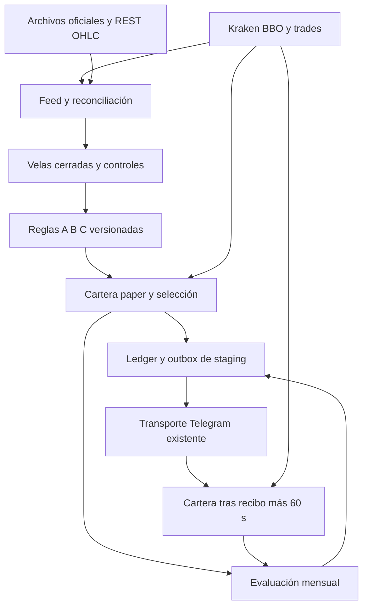

# Lumi Trading — implementación experimental 1.1.0

Estado de entrega: código y pruebas preparados; base de staging migrada. **No está desplegado ni activado. No hay recibo Telegram real.** El 28/10/2026 Render devolvió `suspended: suspended`, `suspenders: [billing]` para `content-factory-av2-staging`, plan `free`. El workspace no tiene otro recurso de cómputo utilizable fuera de producción. La creación de capacidad de pago necesita presupuesto del propietario.

## Aislamiento y ejecución

`npm run trading:worker` ejecuta un worker dedicado, sin servidor HTTP. Usa el mismo `TelegramTransport` de `lib/telegram-review-v1/runtime.js`, mediante importación, y solo llama a `getMe` y `sendMessage`. No cambia dicho transporte, el webhook, las rutas, menús ni callbacks. No consume updates. No toca `server.js`, `public/lumi-studio`, `lib/telegram-mini-app`, sesiones audiovisuales ni panel 148. No se importan `server.js` ni puntos de arranque multimedia.

El worker debe estar supervisado por Render y residir en un servicio separado. El arranque rechaza el ID del web service audiovisual, otro proyecto Supabase, otra rama, un modo distinto de PAPER o variables de claves privadas Kraken. No contiene clientes de órdenes ni fondos.

## Parámetros y semántica

Todas las reglas, costes e hipótesis de fill siguen EXPERIMENTALES. Cuenta ficticia inicial reproducible: 10.000 USD, no atribuida al usuario. Riesgo 0,25 %, riesgo abierto máximo 0,50 %, una posición/reserva por cartera, 10 % de efectivo, exposición máxima 1×, pausa diaria 1 % y drawdown 5 %. Sin préstamo, cortos ejecutables, martingala, parciales ni stops móviles. Los candidatos bajistas se registran como no ejecutables en este spot.

Plan A/B/C de la especificación y adenda: 4 h / 1 h / 15 min; H=32/24/16; entrada stop-limit con límite de 0,10 ATR15; vencimiento dos velas; prioridad A/B/C. Solo confirmaciones posteriores al setup, con join por disponibilidad. EMA y RMA se inicializan mediante SMA; Bollinger usa desviación poblacional. Rechazos por distancia técnica, R neto, costes, liquidez o saldo no alteran niveles para forzar una señal.

Coste de simulación congelado: taker 0,80 % por lado; fuente pública Kraken consultada 28/10/2026, sin asumir una tarifa particular del usuario. Deslizamiento hipotético 2 bps por lado, además del bid/ask observado. Cantidad máxima 10 % del volumen mostrado en ambos mejores niveles. Fill paper completo conservador cuando esa capacidad existe; no equivale a una orden FOK real del exchange. El límite se respeta incluso después de impacto. Cualquier cambio de costes es una nueva política/versionado, no una modificación de operaciones abiertas.

Entrada del motor: después de 1 s. Segunda cartera: después del recibo de API y 60 s de reacción humana. Las carteras tienen capital independiente y nunca se suman como una sola. Una entrega tardía o trigger ya cruzado produce entrada perdida. Un recibo no prueba lectura ni ejecución real. El replay permite 30/60/180/300 s. Los resultados de la segunda cartera no son fills de una cuenta real.

Se usa Decimal para cantidades/dinero. Los indicadores se calculan en números IEEE sobre datos públicos y sus inputs completos quedan guardados. Stop, TP, cantidades y hashes de cada plan se conservan. La recuperación de un posible fill perdido entre ticks y checkpoint usa una trayectoria adversa marcada como ambigua; no convierte automáticamente un pending persistido en una operación no ejecutada. Una vela con ambas barreras resuelve stop primero. Los resultados inciertos quedan visibles y bloquean la validación estadística.

## Feed e historial

Mercado exclusivo: Kraken internacional `XXBTZUSD` REST / `BTC/USD` WS v2, spot. BBO usa `event_trigger=bbo`; trade usa snapshots y trade_id de Kraken. No se supone secuencia en ticker. Timestamps del evento y recepción separados. Heartbeat no renueva precio. Se comprueba reloj con los intervalos `time_in`/`time_out` de confirmaciones y ping/pong. Reloj incierto (>1 s de cota), cotización >5 s o trade >30 s suspenden entradas. Spread máximo 5 bps.

`scripts/trading-bootstrap.py` descargó únicamente miembros `XBTUSD_240.csv` por HTTP Range de los ZIP oficiales 2026Q2 y Q3: 1.098 velas consecutivas. ZIP verifica CRC y el manifest guarda SHA256 de cada miembro descargado; no se afirma verificar el ZIP completo. `data/trading/bootstrap.json` es HISTORICAL_ONLY. Se une con REST reciente y se exige al menos 1.000 velas 4 h antes de evaluar. No se intenta paginar años con `since`. La última fila REST siempre se excluye de indicadores. Las correcciones de histórico no alteran eventos anteriores. La comparación de volúmenes normaliza ocho decimales BTC para distinguir precisión de un cambio sustantivo.

Reconstrucción desde trades en minutos UTC; reconciliación con OHLC oficial al cierre. No se interpolan huecos desconocidos. La evaluación espera al menos 1,5 s tras el cierre y se descarta si la reconciliación excede 10 s. Tras reiniciar/reconectar no se emiten confirmaciones históricas. Las advertencias programadas de mantenimiento spot inhiben nuevas entradas desde `cancel_before_utc`.

## Persistencia y avisos

Migraciones `20261028225142_lumi_trading_paper.sql` y `20261028230201_lumi_trading_fencing_hardening.sql` aplicadas solo a `lumi-av2-staging`. Tablas independientes: `lumi_trading_state`, `lumi_trading_events`, `lumi_trading_outbox`. RLS, permisos service_role, ningún permiso anon/authenticated. RPC invoker con CAS, lease 45 s y fencing. Eventos append-only para el rol del backend. Estado, eventos y outbox se guardan en una transacción, cada dos segundos y antes de notificar. Commit con batch id admite respuesta perdida sin duplicar datos.

Outbox: QUEUED → DISPATCHING → DELIVERED / REJECTED / UNKNOWN / EXPIRED. Un proceso nuevo convierte DISPATCHING abandonados en UNKNOWN; no reenvía. Una señal >30 s desde decisión o vencida no puede reclamarse como vigente. Antes de enviar: destinatario privado activo + allowlist + sesión coincidente; identidad del bot, quote/trade, spread/capacidad, contexto, barreras y trigger. Un máximo de una llamada de envío por ciclo de 5 s, con prioridad de oportunidades. Sin botones ni edición de mensajes anteriores. Mensajes en Europe/Rome con offset dinámico; UTC interno. Se registra preflight, intento, respuesta, ID de mensaje y hash del destinatario; no tokens ni IDs personales en logs.

Los cierres automáticos emiten RESULTADO SIMULADO. Resumen semanal acumulado desde el arranque: candidatos, selección, supresiones, no fills, ganancias/pérdidas, costes, drawdown, abiertas, incidencias y estados de entrega. La prueba técnica solo sale con feed vivo válido y dice PRUEBA DE CONEXIÓN. Su ID durable impide repetirla a ciegas.

## Investigación progresiva

Versión activa estable. Revisión mensual; sin 100 nuevos cierres maduros del motor, INCONCLUSO. Hasta tres candidatas por campaña y 30 intentos totales; las hipótesis quedan registradas antes de observación. Las candidatas y un comparador independiente parten simultáneamente del mismo capital y registran días UTC sin operaciones. Nunca se suman sus beneficios al motor.

Comparación prospectiva por bootstrap de bloques de siete días, 2.000 réplicas y semilla fija. Corrección conservadora Bonferroni sobre todos los intentos. Umbral primario predefinido: límite inferior de mejora diaria neta >0,0002 de equity, sin deterioro material de drawdown. Piso 90 días y 100 fills prospectivos; además 300 OOS, 100 finales, 12 meses, muestra efectiva 200, expectativa ≥0,10 R, PF≥1,20, límites de DD, estabilidad, sensibilidad, estrés y calibración de la especificación. Sin informe histórico completo no hay promoción. Brier, log loss y curvas por bins distinguen timeout de no fill; no se publica probabilidad todavía.

`scripts/trading-replay.mjs` ejecuta replay cronológico fuera del worker y conserva resultados/costes/operaciones abiertas. Requiere manifest e instrumento exacto, rechaza lecturas futuras y orden temporal incorrecto. Incluye benchmarks efectivo, buy-and-hold y EMA200 con costes comparables. Un replay exploratorio nunca se etiqueta como OOS aprobado. Las particiones purgan etiquetas solapadas. No se ha realizado ni declarado una validación histórica de rentabilidad.

La comparación decisiva se hace una sola vez al cumplirse las condiciones; un rechazo finaliza la candidata y no se repite diariamente buscando un resultado favorable. La primera candidata elegible según el orden registrado cierra la campaña. Una promoción solo mueve versión paper después de las puertas; conserva el capital, pérdidas y drawdown de la cartera activa y espera a que no haya planes abiertos. Una reversión técnica registra motivo; con planes abiertos difiere el cambio y pausa nuevas entradas. No cambia instrumento ni riesgo, no habilita dinero real. El historial conserva campañas e intentos fallidos. Estado actual: **sin estrategia aprobada; probabilidad NO DISPONIBLE**.

## Activación preparada y bloqueo

Opción concreta: un background worker Render para staging, 512 MB y menos de una CPU, coste publicado 7 USD/mes de cómputo, más impuestos/excesos si aplican. No creado ni contratado. Supabase existente se reutiliza; tamaño observado antes de migrar: 16 MB. No necesita Redis, disco de pago ni llamadas a modelos. La prueba del feed usó aproximadamente 76 MB RSS; no sustituye medir el worker completo durante carga sostenida. Heap del worker 192 MB, supervisión de RSS 320 MB y CPU; exceder límites persiste incidente y termina para reinicio supervisado. Backtests no se ejecutan en el proceso audiovisual ni en el monitor.

Configuración preparada del worker:

| Campo | Valor |
|---|---|
| Repositorio/rama | AgustinGettar/content-factory-renderer · lumi-telegram-review-v1 |
| Runtime | Node 24 |
| Build | npm ci --omit=dev |
| Start | npm run trading:worker |
| Instancias | 1; el lease también impide duplicados durante despliegues |
| Entorno | LUMI_RUNTIME_ENV=staging; LUMI_TRADING_MODE=PAPER; LUMI_TRADING_ALERTS=true |
| Identidad del worker | LUMI_TRADING_RENDER_SERVICE_ID debe coincidir con su RENDER_SERVICE_ID |
| Secretos | Reutilizar dentro de Render las variables existentes SUPABASE_URL, SUPABASE_SERVICE_ROLE_KEY, LUMI_TELEGRAM_BOT_TOKEN, LUMI_TELEGRAM_BOT_ID, LUMI_TELEGRAM_REVIEW_TEST_USERS y LUMI_TELEGRAM_TRANSPORT_AUTHORITY; no copiarlas a documentos/logs |

El plan gratuito se suspende por inactividad y no garantiza este monitor continuo. No se usa keep-alive artificial ni otro servicio para eludir la suspensión de facturación. Hace falta que el propietario habilite la facturación de Render y autorice el worker de 7 USD/mes. Después, la verificación que queda bloqueada es: despliegue live, copia segura de configuración existente, prueba Telegram con recibo, observación tras reinicio supervisado y métricas reales del worker. No se debe declarar completada antes de esos pasos.

## Evidencia y comandos

`docs/trading/evidence/live-verification.json`: primera captura acotada, 15 muestras válidas, cotizaciones/trades reales y controles del reloj; 1.265 velas 4 h tras reconciliar, SIN_OPORTUNIDAD_VALIDA; inyección sintética stale correctamente bloqueada. Copia persistida y releída en Supabase como LIVE_FEED_VERIFICATION, independiente de señales/resultados.

`docs/trading/evidence/live-probe.json`: repetición independiente. Las muestras marcadas STALE_QUOTE son rechazos, nunca alertas válidas. Estos diagnósticos se detienen tras 60 s y **no son el monitor persistente**.

Pruebas: `node --test test/trading-*.test.js test/lumi-direct-telegram.test.js test/lumi-mini-app-auth.test.js`. Incluyen motor-simulador-outbox, A/B/C, disponibilidad temporal, costes, reservas, reinicio, ambigüedad, SQL real mediante PGlite, aislamiento y transporte. Fixtures sintéticos explícitos, sin API Telegram.

Fuentes verificadas: [Kraken ticker](https://docs.kraken.com/exchange/api-reference/spot-websocket-v2/ticker), [trades](https://docs.kraken.com/exchange/api-reference/spot-websocket-v2/trade), [ping](https://docs.kraken.com/exchange/api-reference/spot-websocket-v2/ping), [históricos oficiales](https://support.kraken.com/articles/360047124832-downloadable-historical-ohlcvt-open-high-low-close-volume-trades-data), [tarifas](https://www.kraken.com/features/fee-schedule), [Render workers](https://render.com/docs/background-workers), [límites free](https://render.com/docs/free), [precios](https://render.com/pricing).

Las versiones de archivo SQL coinciden con el historial aplicado en staging. La verificación final local pasó 54/54 pruebas; registro en `evidence/tests.txt`.
